# Vota Dolores Hidalgo

Plebiscito vecinal en Flutter para Dolores Hidalgo, Guanajuato. Los vecinos votan por la obra que prefieren, las barras de resultado crecen con una animación y al final se revela la opción ganadora. Las reglas del voto viven en una capa de lógica en Dart puro y se construyeron con TDD, ronda por ronda, siguiendo el Manual TDD de la práctica.

**Autor:** Jonathan Venancio Aguilar Hernandez

## 1. Reglas de negocio

| Regla | Resultado del servicio |
|-------|------------------------|
| Se vota por una opción que existe | `exitoso` |
| La opción no existe | `opcionInvalida` |
| Cada usuario vota una sola vez | `usuarioYaVoto` |
| No se vota después de la fecha de cierre | `votacionCerrada` |

Los porcentajes se calculan sobre el total de votos (0 % para todas las opciones si nadie ha votado) y, si dos o más opciones empatan en primer lugar, `determinarGanador()` las devuelve todas en lugar de elegir una al azar. Un intento rechazado no modifica ningún contador.

## 2. Arquitectura

| Capa | Archivos | Responsabilidad |
|------|----------|-----------------|
| Modelos | `lib/modelos/` | `Votacion`, `OpcionVotacion`, `ResultadoOpcion` |
| Lógica | `lib/logica/` | `ServicioVotacion` y el enum `ResultadoVoto` |
| Interfaz | `lib/presentation/votacion_screen.dart` | Pantalla con barras animadas (`TweenAnimationBuilder`) y diálogo del ganador (`ScaleTransition` + `FadeTransition`) |

La pantalla no repite ninguna regla: le pide al servicio los resultados, el ganador y el registro de cada voto. Por eso `lib/modelos` y `lib/logica` se prueban con `flutter test` sin abrir un emulador.

## 3. Estructura

```
vota_dolores_hidalgo/
├── lib/
│   ├── main.dart
│   ├── modelos/
│   │   ├── votacion.dart
│   │   ├── opcion_votacion.dart
│   │   └── resultado_opcion.dart
│   ├── logica/
│   │   ├── servicio_votacion.dart
│   │   └── resultado_voto.dart
│   └── presentation/
│       └── votacion_screen.dart
├── test/
│   └── servicio_votacion_test.dart
├── capturas/tdd/                     # capturas de cada ronda (rojo y verde)
└── pubspec.yaml
```

## 4. Cómo ejecutar

Requisitos: Flutter 3 o superior.

```bash
flutter pub get
flutter test      # 10 pruebas de la lógica
flutter run       # abre la app de votación
```

## 5. Pruebas con TDD, ronda por ronda

Cada ronda sigue el ciclo del manual: primero se escribe una prueba que falla (🔴 rojo), luego el código mínimo para que pase (🟢 verde). Las capturas son del panel *Test Results* de VS Code. Todas las pruebas están en `test/servicio_votacion_test.dart` y comparten esta función de apoyo:

```dart
Votacion _crearVotacionDePrueba({DateTime? fechaCierre}) {
  return Votacion(
    pregunta: 'Pregunta de prueba',
    opciones: [
      OpcionVotacion(id: 'op1', texto: 'Opcion 1'),
      OpcionVotacion(id: 'op2', texto: 'Opcion 2'),
    ],
    fechaCierre: fechaCierre ?? DateTime.now().add(const Duration(days: 7)),
  );
}
```

### Ronda 1 — Registrar un voto válido

**Prueba que se agrega** (`test/servicio_votacion_test.dart`):

```dart
test('registrar un voto valido incrementa el contador de esa opcion', () {
  final votacion = _crearVotacionDePrueba();
  final servicio = ServicioVotacion(votacion);

  final resultado = servicio.registrarVoto(idUsuario: 'user1', idOpcion: 'op1');

  expect(resultado, ResultadoVoto.exitoso);
  expect(votacion.opciones[0].votos, 1);
});
```

🔴 **Rojo.** La prueba falla porque `ServicioVotacion` todavía no tiene `registrarVoto`: VS Code marca el error y la ejecución no registra salida.

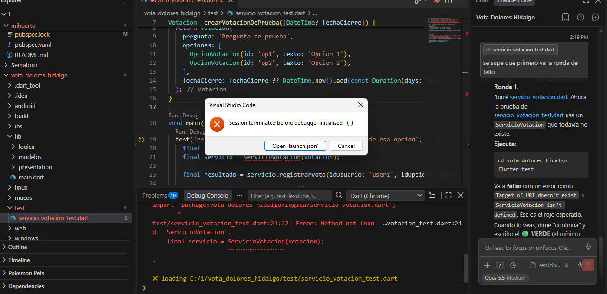

**Código mínimo para pasar** (`lib/logica/servicio_votacion.dart`):

```dart
class ServicioVotacion {
  final Votacion votacion;
  ServicioVotacion(this.votacion);

  ResultadoVoto registrarVoto({required String idUsuario, required String idOpcion}) {
    final opcion = _buscarOpcion(idOpcion);
    opcion!.votos++;
    return ResultadoVoto.exitoso;
  }

  OpcionVotacion? _buscarOpcion(String id) {
    for (final o in votacion.opciones) {
      if (o.id == id) return o;
    }
    return null;
  }
}
```

🟢 **Verde.** Con el código mínimo la prueba pasa. Se usó `opcion!`, que es frágil a propósito: la ronda 2 lo corrige.

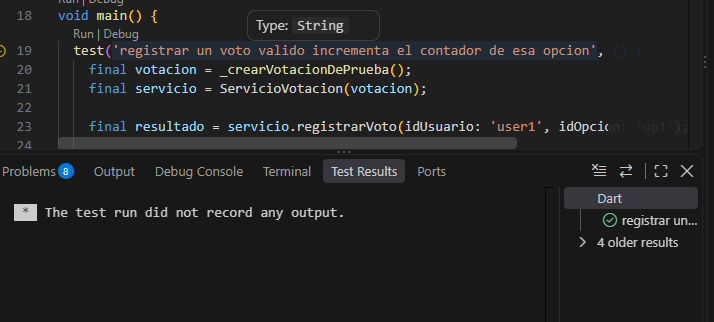

### Ronda 2 — Rechazar votos a opciones que no existen

**Prueba que se agrega** (`test/servicio_votacion_test.dart`):

```dart
test('votar por una opcion que no existe regresa opcionInvalida', () {
  final votacion = _crearVotacionDePrueba();
  final servicio = ServicioVotacion(votacion);

  final resultado = servicio.registrarVoto(idUsuario: 'user1', idOpcion: 'no-existe');

  expect(resultado, ResultadoVoto.opcionInvalida);
});
```

🔴 **Rojo.** Falla con `Null check operator used on a null value`: la opción `no-existe` no se encontró y el `!` truena.

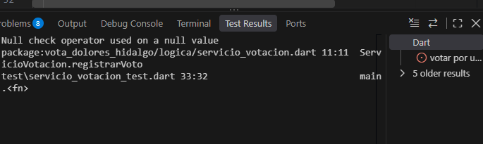

**Código mínimo para pasar** (`lib/logica/servicio_votacion.dart`):

```dart
ResultadoVoto registrarVoto({required String idUsuario, required String idOpcion}) {
  final opcion = _buscarOpcion(idOpcion);
  if (opcion == null) return ResultadoVoto.opcionInvalida;

  opcion.votos++;
  return ResultadoVoto.exitoso;
}
```

🟢 **Verde.** Pasa la prueba nueva y la de la ronda 1 sigue pasando.

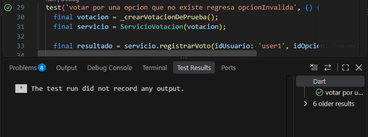

### Ronda 3 — Un usuario no puede votar dos veces

**Prueba que se agrega** (`test/servicio_votacion_test.dart`):

```dart
test('un mismo usuario no puede votar dos veces', () {
  final votacion = _crearVotacionDePrueba();
  final servicio = ServicioVotacion(votacion);

  servicio.registrarVoto(idUsuario: 'user1', idOpcion: 'op1');
  final segundoIntento = servicio.registrarVoto(idUsuario: 'user1', idOpcion: 'op2');

  expect(segundoIntento, ResultadoVoto.usuarioYaVoto);
  expect(votacion.opciones[1].votos, 0); // op2 no debio incrementarse
});
```

🔴 **Rojo.** Falla porque se esperaba `usuarioYaVoto` y el servicio devolvió `exitoso`.

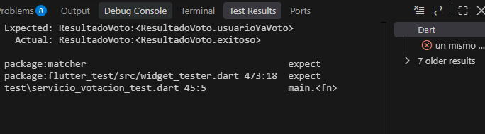

**Código mínimo para pasar** (`lib/logica/servicio_votacion.dart`):

```dart
ResultadoVoto registrarVoto({required String idUsuario, required String idOpcion}) {
  if (votacion.votantes.contains(idUsuario)) return ResultadoVoto.usuarioYaVoto;

  final opcion = _buscarOpcion(idOpcion);
  if (opcion == null) return ResultadoVoto.opcionInvalida;

  opcion.votos++;
  votacion.votantes.add(idUsuario);
  return ResultadoVoto.exitoso;
}
```

🟢 **Verde.** Pasa: el segundo intento del mismo usuario se rechaza y `op2` queda en 0 votos.

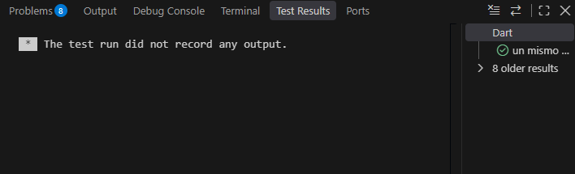

### Ronda 4 — Calcular resultados con porcentajes

**Prueba que se agrega** (`test/servicio_votacion_test.dart`):

```dart
test('calcula el porcentaje de cada opcion correctamente', () {
  final votacion = _crearVotacionDePrueba();
  final servicio = ServicioVotacion(votacion);
  servicio.registrarVoto(idUsuario: 'u1', idOpcion: 'op1');
  servicio.registrarVoto(idUsuario: 'u2', idOpcion: 'op1');
  servicio.registrarVoto(idUsuario: 'u3', idOpcion: 'op1');
  servicio.registrarVoto(idUsuario: 'u4', idOpcion: 'op2');

  final resultados = servicio.obtenerResultados();

  final op1 = resultados.firstWhere((r) => r.opcion.id == 'op1');
  final op2 = resultados.firstWhere((r) => r.opcion.id == 'op2');
  expect(op1.porcentaje, 75.0);
  expect(op2.porcentaje, 25.0);
});

test('si no hay ningun voto, todos los porcentajes son 0', () {
  final votacion = _crearVotacionDePrueba();
  final servicio = ServicioVotacion(votacion);

  final resultados = servicio.obtenerResultados();

  expect(resultados.every((r) => r.porcentaje == 0), true);
});
```

🔴 **Rojo.** Falla porque `obtenerResultados()` todavía no existe (VS Code avisa "Errors exist in your project").

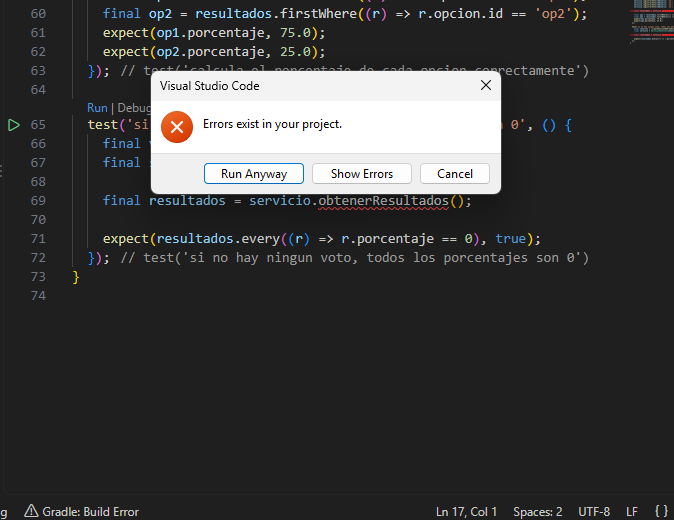

**Código mínimo para pasar** (`lib/logica/servicio_votacion.dart`):

```dart
List<ResultadoOpcion> obtenerResultados() {
  final total = votacion.opciones.fold<int>(0, (suma, o) => suma + o.votos);
  return votacion.opciones.map((o) {
    final porcentaje = total == 0 ? 0.0 : (o.votos / total) * 100;
    return ResultadoOpcion(o, porcentaje);
  }).toList();
}
```

🟢 **Verde.** Pasan las dos pruebas. La de "sin votos" evita dividir entre cero (`total == 0`).

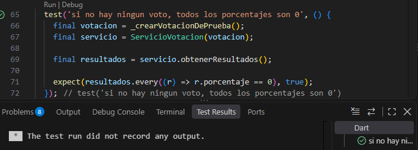

### Ronda 5 — Determinar el ganador

**Prueba que se agrega** (`test/servicio_votacion_test.dart`):

```dart
test('determinarGanador regresa la opcion con mas votos', () {
  final votacion = _crearVotacionDePrueba();
  final servicio = ServicioVotacion(votacion);
  servicio.registrarVoto(idUsuario: 'u1', idOpcion: 'op1');
  servicio.registrarVoto(idUsuario: 'u2', idOpcion: 'op1');
  servicio.registrarVoto(idUsuario: 'u3', idOpcion: 'op2');

  final ganadores = servicio.determinarGanador();

  expect(ganadores.length, 1);
  expect(ganadores.first.id, 'op1');
});
```

🔴 **Rojo.** Falla porque `determinarGanador()` todavía no existe.

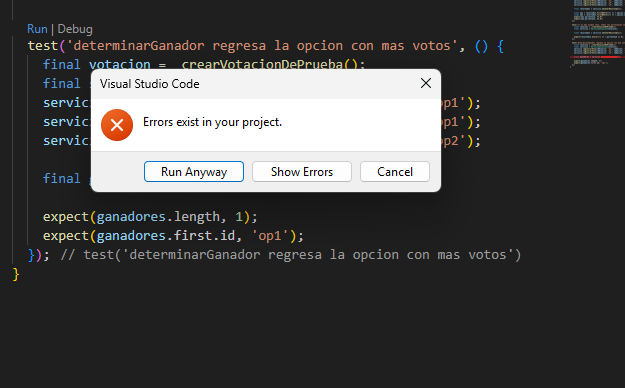

**Código mínimo para pasar** (`lib/logica/servicio_votacion.dart`):

```dart
List<OpcionVotacion> determinarGanador() {
  final maxVotos = votacion.opciones.map((o) => o.votos).reduce((a, b) => a > b ? a : b);
  return votacion.opciones.where((o) => o.votos == maxVotos).toList();
}
```

🟢 **Verde.** Pasa: con 2 votos contra 1 gana `op1`.

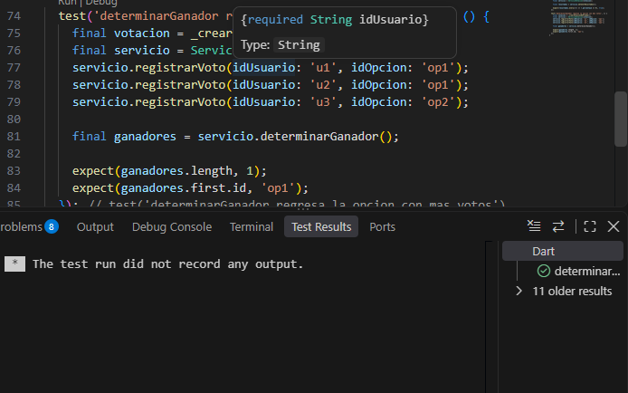

### Ronda 6 — Reconocer un empate

**Prueba que se agrega** (`test/servicio_votacion_test.dart`):

```dart
test('si hay empate, determinarGanador regresa mas de una opcion', () {
  final votacion = Votacion(
    pregunta: 'Pregunta de prueba',
    opciones: [
      OpcionVotacion(id: 'op1', texto: 'Opcion 1'),
      OpcionVotacion(id: 'op2', texto: 'Opcion 2'),
      OpcionVotacion(id: 'op3', texto: 'Opcion 3'),
    ],
    fechaCierre: DateTime.now().add(const Duration(days: 7)),
  );
  final servicio = ServicioVotacion(votacion);
  servicio.registrarVoto(idUsuario: 'u1', idOpcion: 'op1');
  servicio.registrarVoto(idUsuario: 'u2', idOpcion: 'op2');
  servicio.registrarVoto(idUsuario: 'u3', idOpcion: 'op3');

  final ganadores = servicio.determinarGanador();

  expect(ganadores.length, 3);
});
```

**Código mínimo para pasar** (`lib/logica/servicio_votacion.dart`):

```dart
// No hay cambios: where() de la ronda 5 ya devolvía todas las opciones con el máximo de votos.
```

🟢 **Verde.** Esta prueba pasa de inmediato, sin tocar el código. Se conserva porque protege el manejo de empates.

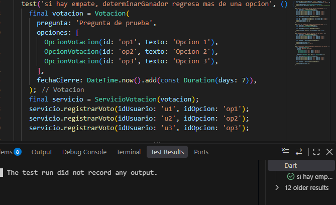

### Ronda 7 — No se puede votar después del cierre

**Prueba que se agrega** (`test/servicio_votacion_test.dart`):

```dart
test('no se puede votar si la votacion ya cerro', () {
  final votacionCerrada = _crearVotacionDePrueba(
    fechaCierre: DateTime(2000, 1, 1), // una fecha muy en el pasado
  );
  final servicio = ServicioVotacion(votacionCerrada);

  final resultado = servicio.registrarVoto(idUsuario: 'user1', idOpcion: 'op1');

  expect(resultado, ResultadoVoto.votacionCerrada);
  expect(votacionCerrada.opciones[0].votos, 0);
});

test('si la votacion sigue abierta, el voto se registra normalmente', () {
  final votacionAbierta = _crearVotacionDePrueba(
    fechaCierre: DateTime.now().add(const Duration(days: 1)),
  );
  final servicio = ServicioVotacion(votacionAbierta);

  final resultado = servicio.registrarVoto(idUsuario: 'user1', idOpcion: 'op1');

  expect(resultado, ResultadoVoto.exitoso);
});
```

🔴 **Rojo.** La prueba `no se puede votar si la votacion ya cerro` falla: se esperaba `votacionCerrada` y devolvió `exitoso`.

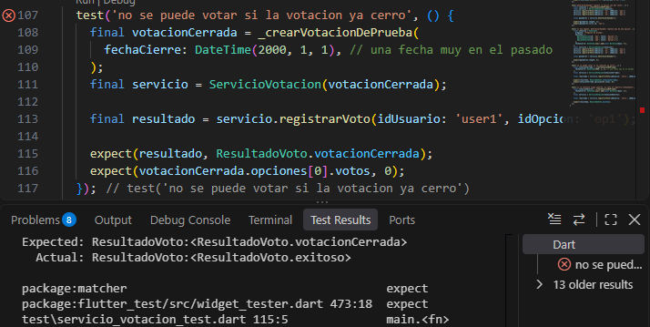

**Código mínimo para pasar** (`lib/logica/servicio_votacion.dart`):

```dart
ResultadoVoto registrarVoto({required String idUsuario, required String idOpcion}) {
  if (DateTime.now().isAfter(votacion.fechaCierre)) return ResultadoVoto.votacionCerrada;
  if (votacion.votantes.contains(idUsuario)) return ResultadoVoto.usuarioYaVoto;

  final opcion = _buscarOpcion(idOpcion);
  if (opcion == null) return ResultadoVoto.opcionInvalida;

  opcion.votos++;
  votacion.votantes.add(idUsuario);
  return ResultadoVoto.exitoso;
}
```

🟢 **Verde.** Pasan las dos pruebas: la votación cerrada rechaza el voto y la abierta lo registra.

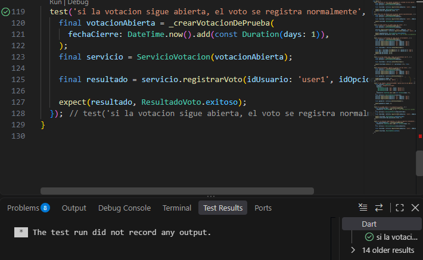

### Ronda 8 — Refactor: guard clauses más legibles

🔵 **Refactor.** No se agrega ninguna prueba. Se les da nombre a las condiciones de `registrarVoto()` para que se lea como una lista de reglas, y las pruebas anteriores deben seguir en verde.

```dart
ResultadoVoto registrarVoto({required String idUsuario, required String idOpcion}) {
  final yaCerro = DateTime.now().isAfter(votacion.fechaCierre);
  if (yaCerro) return ResultadoVoto.votacionCerrada;

  final yaVoto = votacion.votantes.contains(idUsuario);
  if (yaVoto) return ResultadoVoto.usuarioYaVoto;

  final opcion = _buscarOpcion(idOpcion);
  if (opcion == null) return ResultadoVoto.opcionInvalida;

  opcion.votos++;
  votacion.votantes.add(idUsuario);
  return ResultadoVoto.exitoso;
}
```

### Prueba de integración — un plebiscito completo

Simula una votación de principio a fin, incluido un intento de voto repetido. Pasa sin escribir código nuevo.

```dart
test('simulacion completa: varios vecinos votan y se determina un ganador', () {
  final votacion = Votacion(
    pregunta: 'Que obra prioritaria debe realizar el municipio?',
    opciones: [
      OpcionVotacion(id: 'jardin', texto: 'Rehabilitacion del Jardin Principal'),
      OpcionVotacion(id: 'biblioteca', texto: 'Nueva Biblioteca Digital'),
      OpcionVotacion(id: 'alumbrado', texto: 'Alumbrado en el Barrio de Analco'),
    ],
    fechaCierre: DateTime.now().add(const Duration(days: 3)),
  );
  final servicio = ServicioVotacion(votacion);

  servicio.registrarVoto(idUsuario: 'vecino1', idOpcion: 'jardin');
  servicio.registrarVoto(idUsuario: 'vecino2', idOpcion: 'jardin');
  servicio.registrarVoto(idUsuario: 'vecino3', idOpcion: 'biblioteca');
  servicio.registrarVoto(idUsuario: 'vecino1', idOpcion: 'alumbrado'); // repetido: no debe contar

  final resultados = servicio.obtenerResultados();
  final totalVotos = resultados.fold<double>(0, (s, r) => s + r.opcion.votos);
  final ganadores = servicio.determinarGanador();

  expect(totalVotos, 3); // el intento repetido de vecino1 no debio contar
  expect(ganadores.length, 1);
  expect(ganadores.first.id, 'jardin');
});
```

### Resultado final

Con el refactor y la prueba de integración, las 10 pruebas pasan en verde:

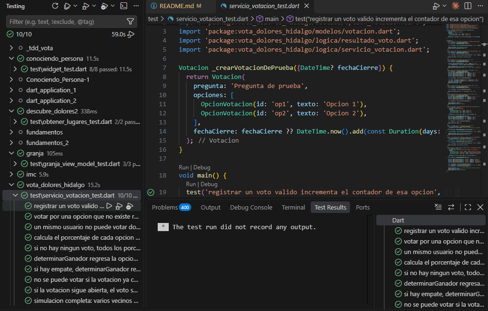

### Resumen de rondas

| Ronda | Qué se prueba | Pruebas acumuladas |
|-------|---------------|--------------------|
| 1 | Un voto válido suma a su opción | 1 |
| 2 | Opción inexistente → `opcionInvalida` | 2 |
| 3 | Un usuario no vota dos veces | 3 |
| 4 | Porcentajes y caso sin votos | 5 |
| 5 | Ganador con más votos | 6 |
| 6 | Empate devuelve todas las opciones empatadas | 7 |
| 7 | Votación cerrada y votación abierta | 9 |
| 8 | Refactor sin cambiar comportamiento | 9 |
| Integración | Plebiscito completo con voto repetido | 10 |

> La interfaz (`votacion_screen.dart`) está implementada según el manual. En la ronda 8 y en la integración no hay captura individual; el resultado conjunto es la captura de 10 de 10.
