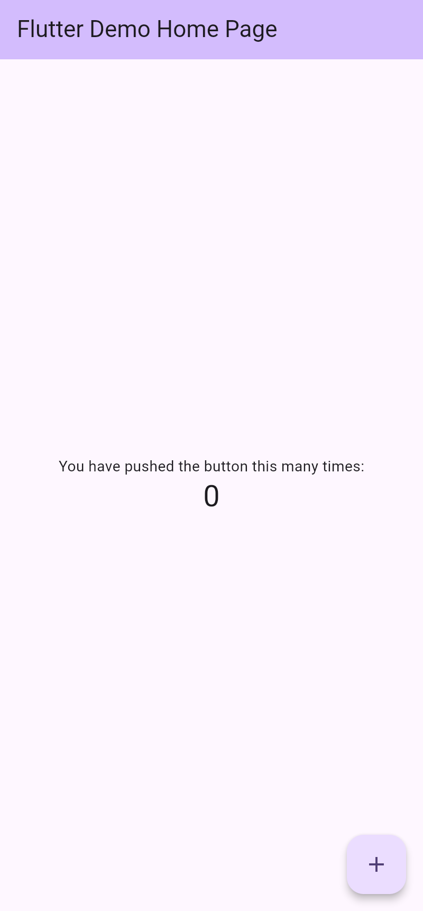
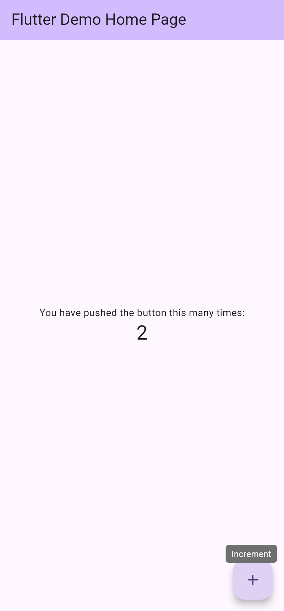
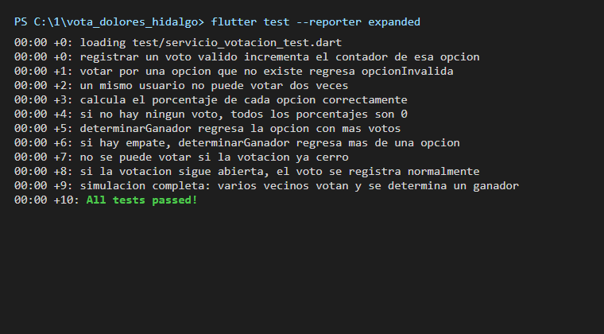

# Vota Dolores Hidalgo

Proyecto en Flutter que modela una votación ciudadana para Dolores Hidalgo, Guanajuato. El trabajo de la actividad está en la lógica de negocio: registrar votos, impedir que un vecino vote dos veces, cerrar la votación en una fecha límite, calcular porcentajes y determinar al ganador. Esa lógica se comprueba con 10 pruebas automáticas.

**Autor:** Jonathan Venancio Aguilar Hernandez

## 1. Descripción breve

Una votación (`Votacion`) tiene una pregunta, una lista de opciones y una fecha de cierre. El servicio `ServicioVotacion` recibe cada intento de voto y responde con un resultado claro en lugar de lanzar errores:

| Resultado | Cuándo se devuelve |
|-----------|--------------------|
| `exitoso` | El voto se registró |
| `votacionCerrada` | La fecha de cierre ya pasó |
| `usuarioYaVoto` | El usuario ya había votado en esa votación |
| `opcionInvalida` | La opción elegida no existe |

Las validaciones se hacen en ese orden: primero el cierre, luego el voto repetido y al final la existencia de la opción. Un intento rechazado no modifica ningún contador.

Además, el servicio calcula el porcentaje de cada opción (0 % para todas si aún no hay votos) y determina el ganador. Si hay empate, devuelve todas las opciones empatadas.

> La interfaz (`lib/main.dart`) sigue siendo la pantalla de ejemplo que genera Flutter (el contador). Todavía no está conectada a la lógica de votación, por eso las capturas de la app muestran ese contador.

## 2. Arquitectura

El código separa los datos de las reglas que operan sobre ellos:

| Carpeta | Contenido |
|---------|-----------|
| `lib/modelos` | Clases de datos: `Votacion`, `OpcionVotacion` y `ResultadoOpcion` |
| `lib/logica` | Reglas de negocio: `ServicioVotacion` y el enum `ResultadoVoto` |

`ServicioVotacion` no depende de Flutter ni de ninguna pantalla, así que se prueba con `flutter test` sin abrir un emulador.

## 3. Estructura del código

```
vota_dolores_hidalgo/
├── lib/
│   ├── main.dart                     # Interfaz base (plantilla de Flutter)
│   ├── modelos/
│   │   ├── votacion.dart             # Pregunta, opciones, fecha de cierre y votantes
│   │   ├── opcion_votacion.dart      # Opción con id, texto y contador de votos
│   │   └── resultado_opcion.dart     # Opción junto con su porcentaje
│   └── logica/
│       ├── servicio_votacion.dart    # Registrar votos, resultados y ganador
│       └── resultado_voto.dart       # Enum con los cuatro resultados posibles
├── test/
│   └── servicio_votacion_test.dart   # 10 pruebas de la lógica
├── capturas/                         # Imágenes usadas en este README
└── pubspec.yaml
```

## 4. Cómo ejecutar

Requisitos: Flutter 3 o superior (Dart 3.13).

```bash
# 1) Dependencias
flutter pub get

# 2) Ejecutar la app
flutter run
```

## 5. Screenshots

La app muestra por ahora la pantalla base de Flutter.

### Pantalla inicial



### Después de presionar el botón



## 6. Pruebas (`flutter test`)

```bash
flutter test
```

Resultado de la ejecución:



Las pruebas están en `test/servicio_votacion_test.dart`:

| Prueba | Qué comprueba |
|--------|---------------|
| Voto válido | Incrementa el contador de la opción elegida |
| Opción inexistente | Devuelve `opcionInvalida` |
| Voto repetido | El mismo usuario no puede votar dos veces y la otra opción no suma |
| Porcentajes | Con 3 votos contra 1 resultan 75 % y 25 % |
| Sin votos | Todos los porcentajes son 0 |
| Ganador | Devuelve la opción con más votos |
| Empate | Devuelve todas las opciones empatadas |
| Votación cerrada | Con fecha de cierre pasada devuelve `votacionCerrada` y no cuenta el voto |
| Votación abierta | Con fecha futura el voto se registra con normalidad |
| Simulación completa | Tres vecinos votan por obras del municipio; el intento repetido no cuenta y gana el Jardín Principal |
